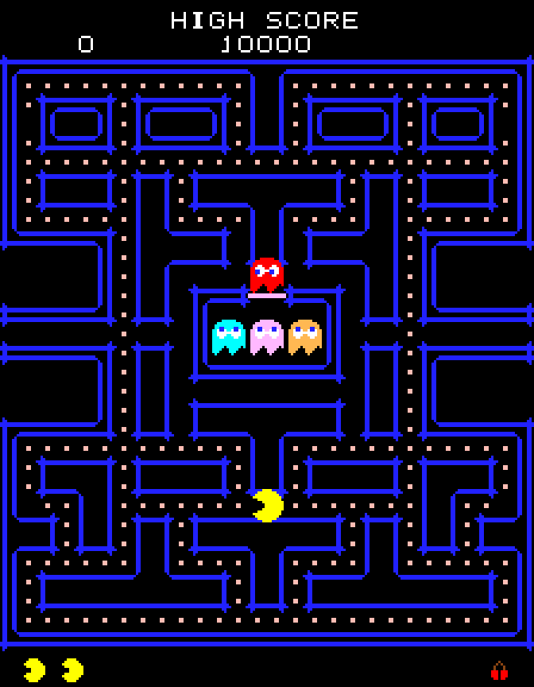

# Pac-Man (Rust)

A faithful clone of the 1980 arcade classic Pac-Man, written in Rust. The game
logic is a headless, deterministic core (`src/logic/`) with no rendering or I/O
dependencies, wrapped in a [macroquad](https://macroquad.rs) presentation layer
that renders and plays sound procedurally — no asset files.



## Features

- Exact 28×36 tile maze with the original layout and arcade palette
- Ghost AI faithful to the original: per-ghost tile targeting (Blinky, Pinky,
  Inky, Clyde), scatter/chase scheduling, frightened mode, ghost-house release
  dot counters, and tunnel slowdown
- Pac-Man cornering, direction buffering, and level speed scaling
- Scoring: dots, power pellets, ghost combos (200/400/800/1600), per-level
  fruit, and an extra life at 10,000
- Procedural 8×8 pixel font, wall outlines, and sprites — everything drawn in
  code
- Procedurally synthesized audio: waka-waka, sirens, power-pellet surge,
  death warble, fruit and extra-life jingles
- Deterministic headless simulation with tests (`tests/headless_sim.rs`),
  ready for future RL training use

## Building

Requires Rust (install via [rustup](https://rustup.rs)). Native builds use
ALSA audio on Linux.

```sh
cargo build --release
```

## Running

```sh
cargo run --release
```

Arrow keys to steer. Collect all dots to clear the level.

## Testing

The logic core is deterministic and fully testable headlessly:

```sh
cargo test
```

## Structure

- `src/logic/` — deterministic game core (maze, ghosts, pacman, scoring)
- `src/render.rs` — macroquad renderer (offscreen 224×288 target, scaled up)
- `src/audio.rs` — WAV-synthesized sound effects
- `src/input.rs` — keyboard input mapping
- `tests/headless_sim.rs` — determinism/consistency tests
- `PLAN.md` — design notes and the frozen logic/presentation API contract
